## SharePoint Online Data Source

This guide explains how to connect your agency's SharePoint Online (SPO) content to an [Enterprise Index](index-enterprise.md) so users can search for it through SearchSG.

Setup involves two separate processes:

- **Outside the Admin Portal**: Request service accounts through the ITSM portal and arrange access to your SharePoint sites.
- **In the Admin Portal**: Create the data source, then authorise and verify the service accounts.

You can save the data source before credentials are ready, but it cannot begin indexing until the required credential setup, account authorisation and connection verification are complete.

!> This guide covers SharePoint Online in the **WOG tenant (CCE)** only. Agency-managed SharePoint Online tenants and SharePoint Server (on-premises) are not covered.

### Before You Begin

#### Identify Your Tenant

| Tenant | Onboarding approach |
|---|---|
| **WOG tenant** | Self-onboarding is available for the WOG tenant (CCE). Follow this guide to arrange account and site access setup, then configure and connect the data source. |
| **Agency-managed tenant** | [Contact SearchSG Support](https://go.gov.sg/searchsg-request) to confirm your tenant's connection requirements and onboarding approach. |

If you are unsure which tenant you use, check with your agency's IT administrator.

#### What You Will Need

- Project owner or editor access to the relevant project.
- An Enterprise Index, or permission to [create one](index-enterprise.md#how-to-create-an-enterprise-index).
- A name for the data source.
- The SharePoint site URLs you want to index, and the content within them that your agency has approved for indexing.
- An agency IT contact who will coordinate account creation and site access.

### Part 1: Request Service Accounts (Outside the Admin Portal)

SearchSG uses an Azure Service Principal Account to access your SharePoint sites. This is an offline process completed through the ITSM portal.

#### Step 1: Contact SearchSG Support

- [Contact SearchSG Support](https://go.gov.sg/searchsg-request) for the support emails required for the account creation request and guidance on the required permissions.

#### Step 2: Open the ITSM Portal

- Sign in to the ITSM portal and go to the **Others** tab.

#### Step 3: Select the Account Creation Service

- Select **Azure Identity Services**.
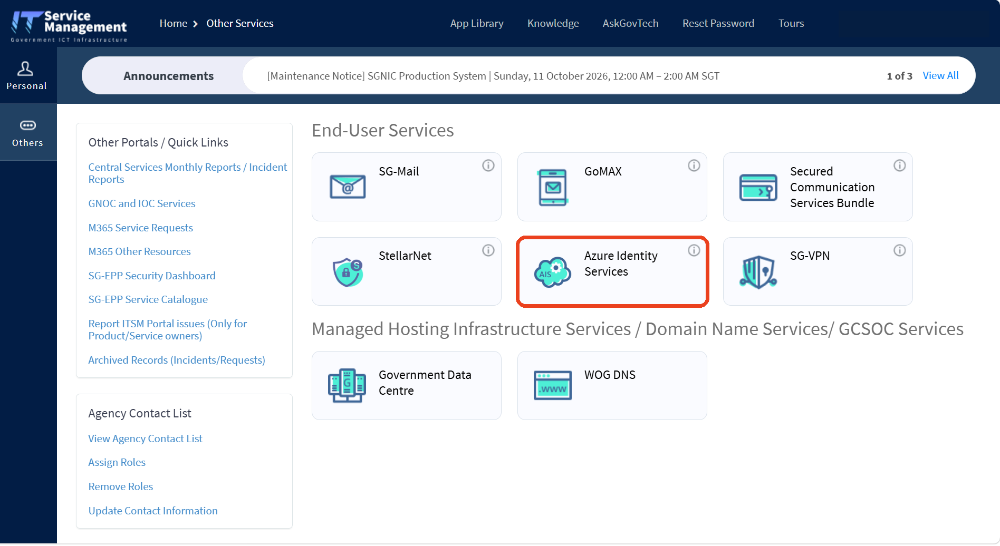
- Select **AIS** to view the list of services.
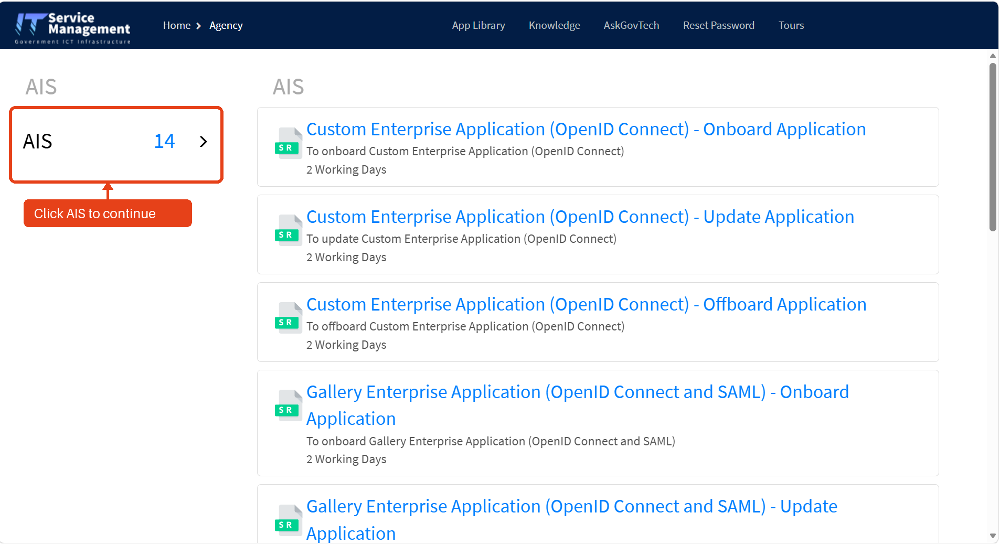
- Select **Azure Service Principal Account – Create**.
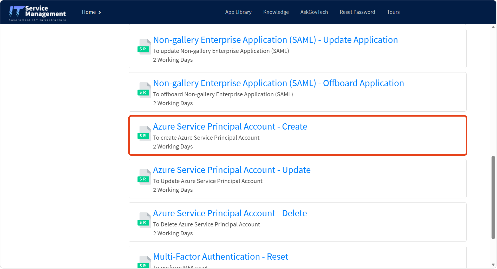

#### Step 4: Complete the Service Request

- Complete the required fields in the ITSM request form, including the purpose of the account and the permission justification as advised by SearchSG Support.

**Purpose of the account**

An Azure Service Principal is an application identity that allows SearchSG to authenticate to your agency's SharePoint Online environment without using an individual staff member's account. With the required permissions and site access granted, SearchSG uses this identity to read content from the intended SharePoint sites and index it for search.

Include the account's purpose when submitting the ITSM request. You can use the following wording, adapting it to your agency and intended SharePoint sites:

> To enable SearchSG to authenticate to our agency's SharePoint Online environment using a dedicated application identity, read content from the approved SharePoint sites, and index that content so it can be searched through SearchSG. Access should be limited to the permissions and sites required for this integration, as confirmed with SearchSG support.

?> The purpose statement does not replace the permission justification. Include the specific permissions and justification confirmed by SearchSG Support. If you are unsure which permissions to request, contact SearchSG Support before submitting.

#### Step 5: Attach the Support Emails

- Attach the support emails obtained from SearchSG Support to the service request.

#### Step 6: Review and Submit

- Check that:
    - All required fields in the ITSM request form are completed accurately.
    - The required permissions and justification are included.
    - The support emails are attached.
- Submit the service request.

#### Step 7: Save Your Request Reference

- Record the service request reference number so you can track its progress and quote it when following up.

?> Account creation alone does not grant access to your SharePoint sites or mean the data source is ready to sync. You can continue with [Part 2](index-enterprise-sharepoint.md#part-2-add-a-sharepoint-online-data-source) while the request is being processed.

### Part 2: Add a SharePoint Online Data Source

#### Step 1: Open the Data Sources Tab

- Open the `Index Library`, select your Enterprise Index, and select the **Data Sources** tab.
- If you do not have an Enterprise Index yet, follow [How to Create an Enterprise Index](index-enterprise.md#how-to-create-an-enterprise-index) first.

#### Step 2: Select Microsoft SharePoint and the Hosting Mode

1. In **Platform data sources**, click **"Add new +"** and select **Microsoft SharePoint**.
2. In the **Select SharePoint type** pop-up window, open the **Hosting mode** dropdown and select `WOG SharePoint Online Tenant`.
3. Click **"Next"** to open **Add platform data source**.
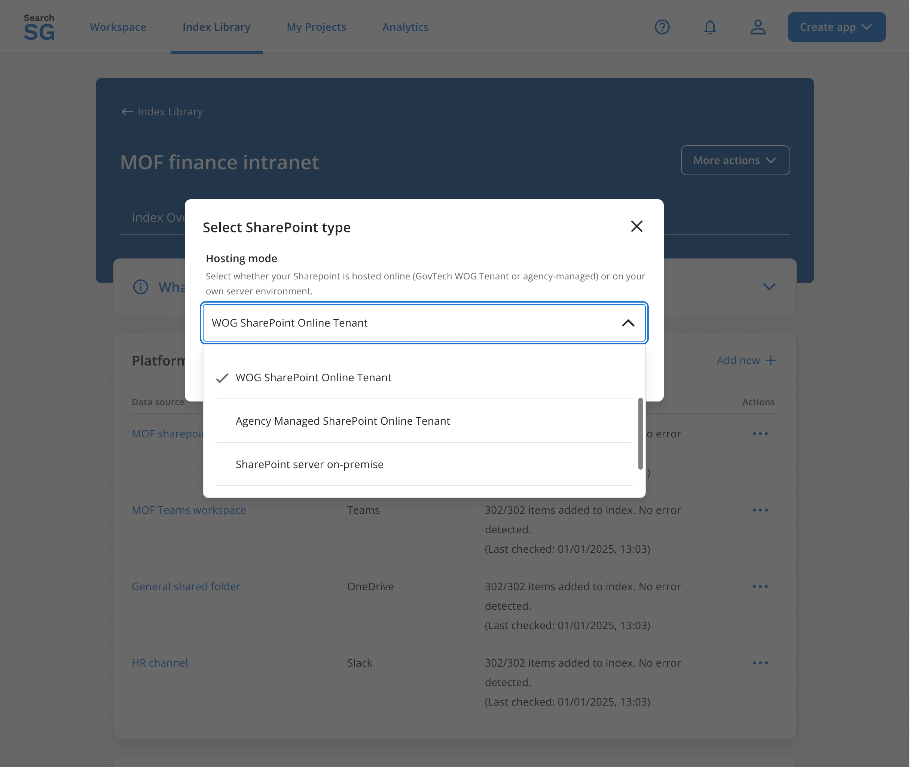

#### Step 3: Complete Basic Setup and SharePoint Configuration

1. Under **Basic setup**, enter the **Platform data source name**. This is for your agency's internal reference.
2. Under **SharePoint configuration**, complete **Enter a SharePoint data source name**.
3. In **List of site URLs (max. 20 URLs)**, enter the SharePoint site URLs to index, with one URL per line. Only the sites listed here will be indexed.
4. *(Optional)* Enter URLs to exclude in **Domain blacklisted pages**, with one URL per line.
5. *(Optional)* Enter file extensions in **Exclude file types**, separated by commas, for example `.jpg, .mp4, .tmp, .log, .exe, .dll, .zip`. Files matching these extensions will not be crawled or indexed.
6. Review the details and click **"Next"**.
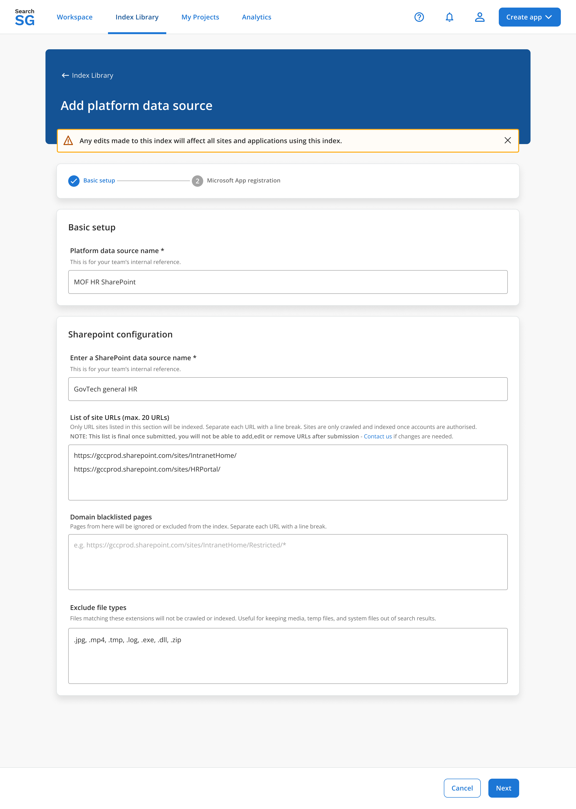

If validation fails, correct the highlighted fields before continuing. Check for missing required fields, duplicate URLs, unsupported sites or tenants, and the maximum of 20 site URLs.

#### Step 4: Confirm Your SharePoint URLs

- In the **Confirm your SharePoint URLs** pop-up window, double-check each URL. Click **"Cancel"** to return and make corrections, or **"Continue"** to proceed.

!> The site URL list is final once submitted. You cannot add, edit or remove site URLs yourself after submission. Contact SearchSG Support if changes are needed.

#### Step 5: Create the Data Source

- Review the provisioning information on the **Microsoft App registration** step, then click **"Done"** to create your data source.
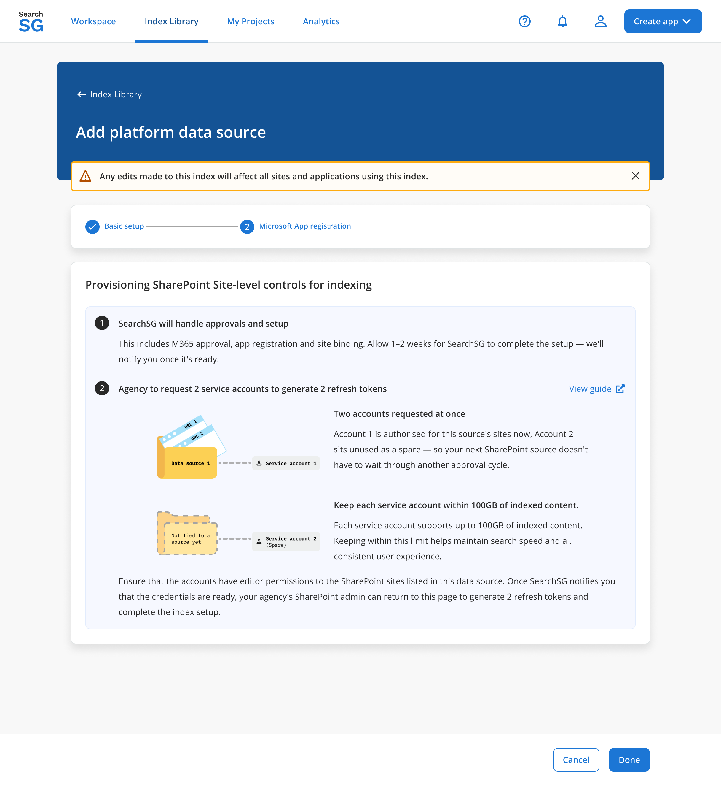
- The data source will appear in the **Data Sources** tab with `Pending credentials` status.
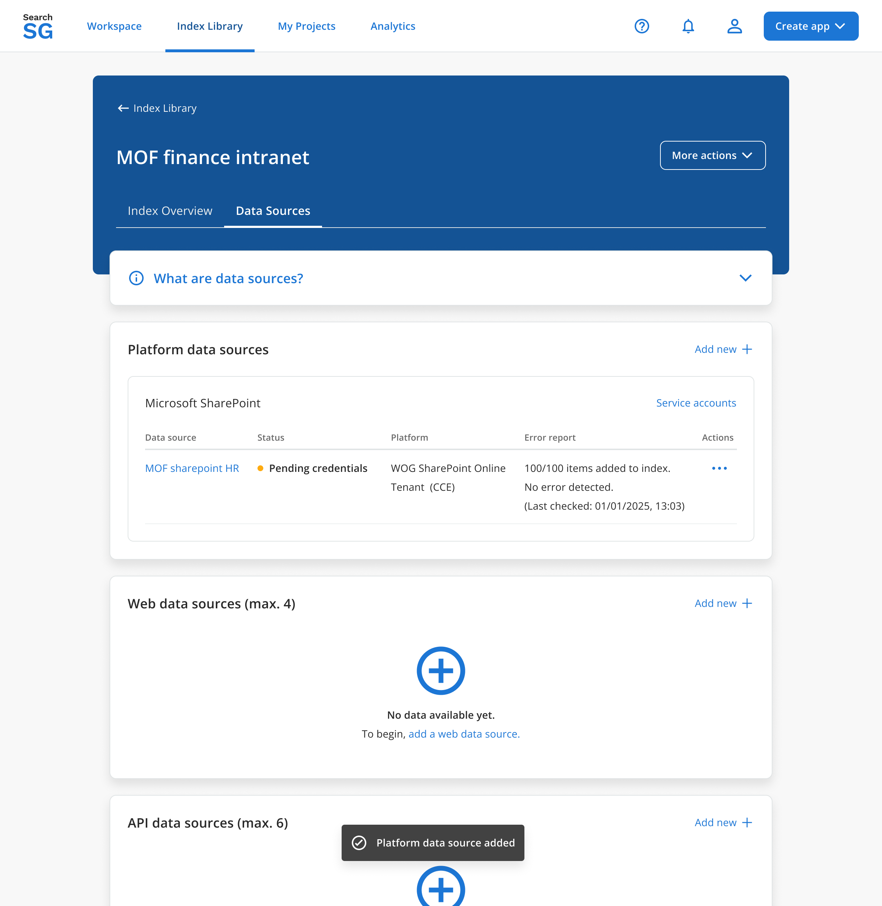

### Part 3: Wait for SearchSG to Complete Setup

While the data source shows `Pending credentials`, SearchSG will coordinate access requests for your submitted SharePoint URLs and complete credential setup. You do not need to enter credentials in the Admin Portal.
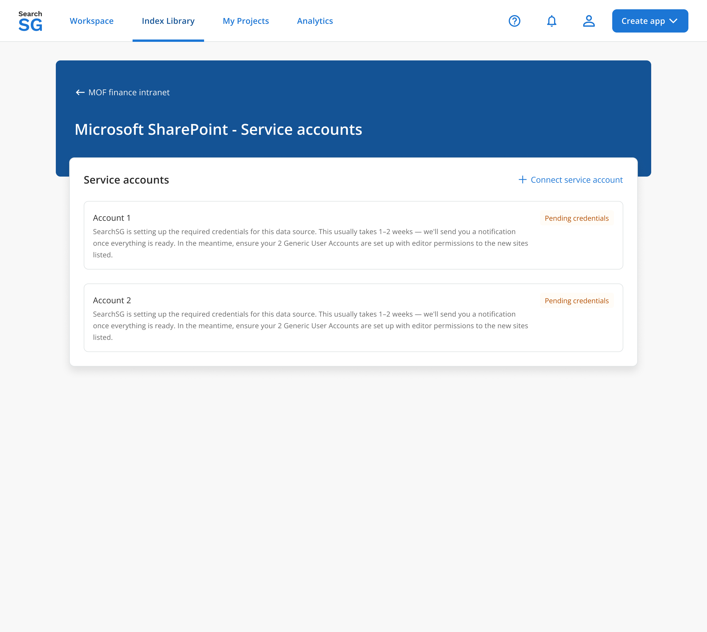

While setup is in progress, your agency should:

- Complete [Part 1: Request Service Accounts](index-enterprise-sharepoint.md#part-1-request-service-accounts-outside-the-admin-portal) to have two accounts created.
- Ensure the service accounts have site admin access to the listed SharePoint sites, so they can access all files, folders and pages, including their access control lists (ACLs).

!> Wait for the confirmation email from SearchSG Support before continuing in the Admin Portal. Your data source will not start indexing until setup, account authorisation and verification are complete.

To change the submitted SharePoint URLs or check setup progress, contact SearchSG Support.

### Part 4: Authorise and Verify Service Accounts

Once SearchSG Support confirms that setup is complete, return to the Admin Portal to authorise your agency's service accounts.

#### Step 1: Open the Service Accounts Page

1. Open the `Index Library`, select your Enterprise Index, and select the **Data Sources** tab.
2. Under **Platform data sources** → **Microsoft SharePoint**, click **"Service accounts"**.
3. Find the account you want to authorise and click **"Authorise account"**.
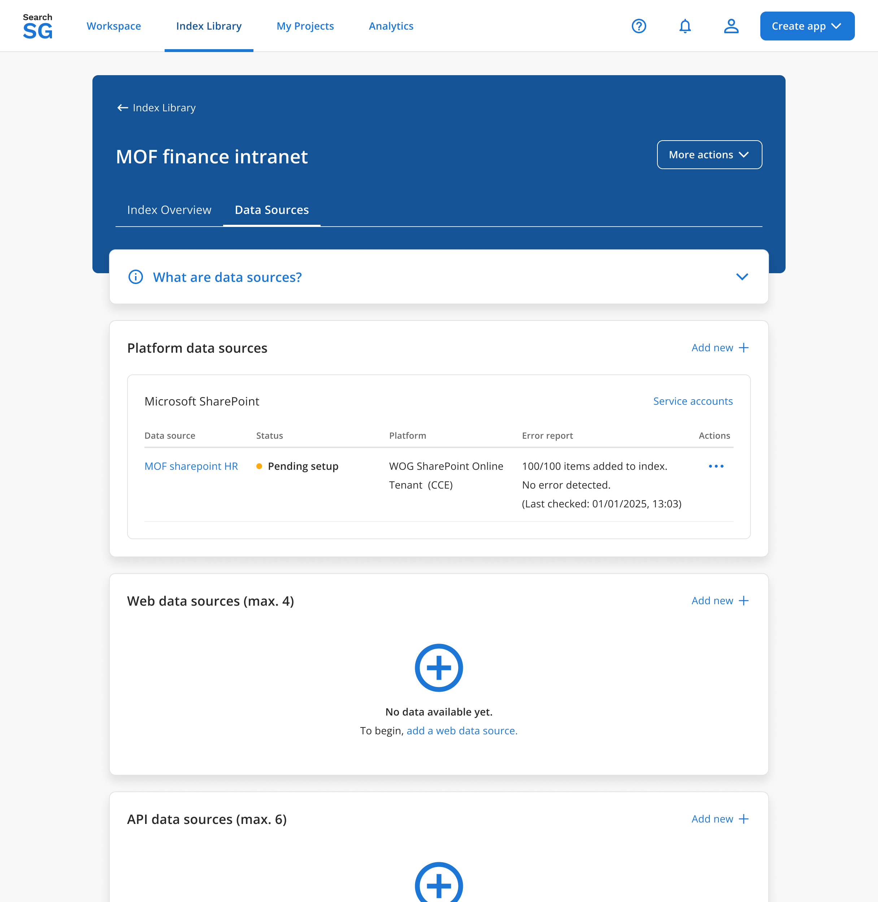
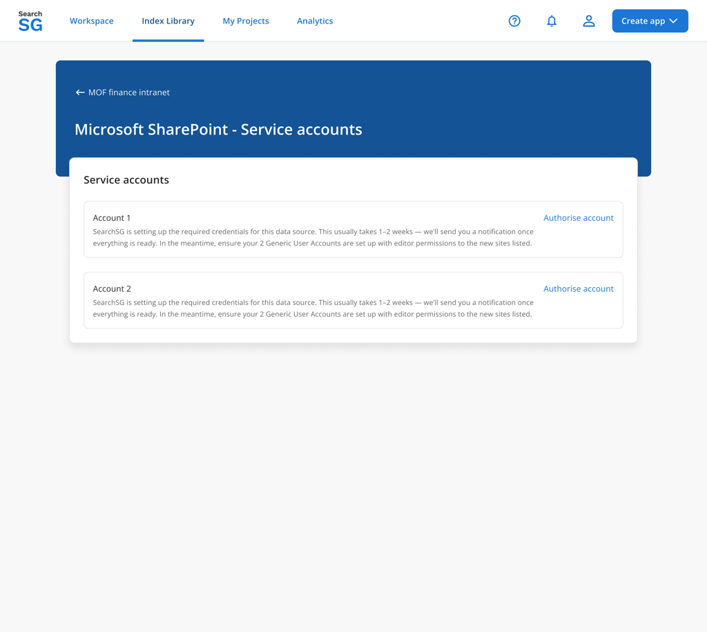

#### Step 2: Authorise the Account

1. In the **Credentials required** pop-up window, copy the authorisation link.
2. Open the link in an incognito/private browser window.
3. Sign in with your agency's **service account**, not your personal account.
4. Accept the requested permissions.
5. When authorisation succeeds, close the window and return to the Admin Portal.
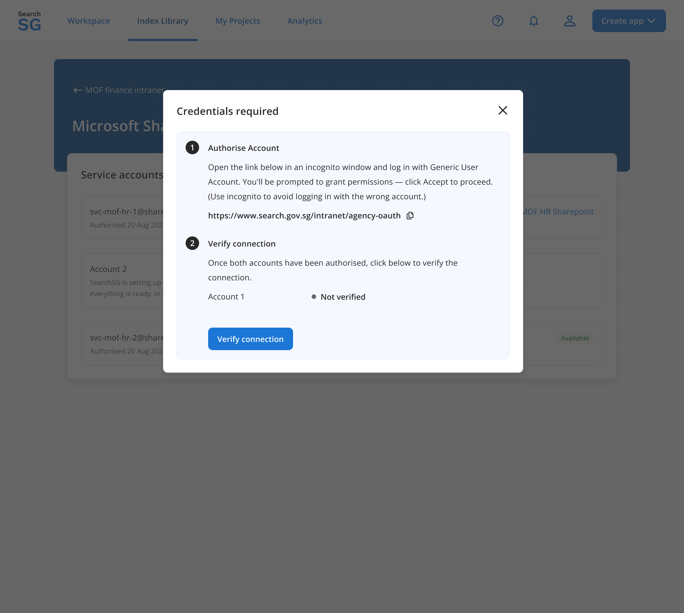

?> To authorise another account, close all incognito windows first, then open its link in a fresh private session.

#### Step 3: Verify the Connection

1. Return to the **Credentials required** pop-up window and click **"Verify connection"**.
2. Wait for verification to complete.
3. When the account shows `Verified`, click **"Done"**.
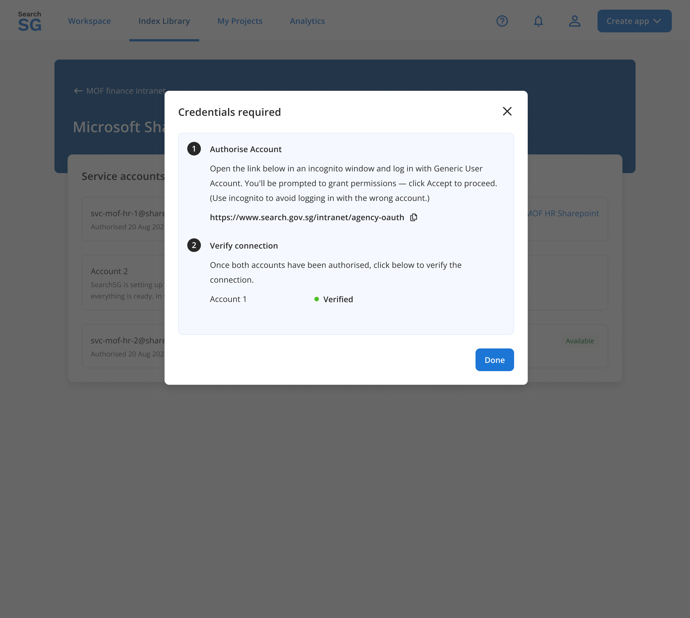

- You will see a **Service account verified** confirmation.
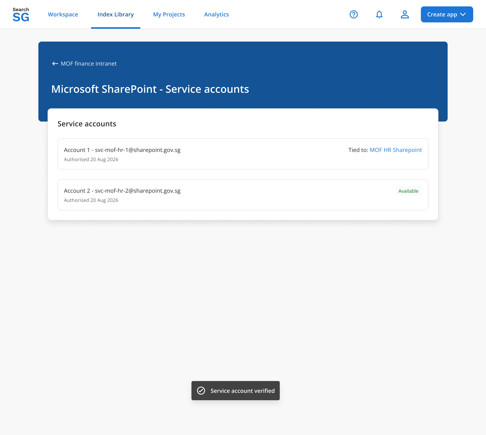

?> Verification confirms the account connection; it does not mean that indexing has finished.

If authorisation or verification fails, see [Troubleshooting](index-enterprise-sharepoint.md#troubleshooting).

### Part 5: Check Indexing Progress

You will receive an email when your data source is connected and indexing has begun.

To check progress:

1. Open your index's **Data Sources** tab.
2. Select the SharePoint data source name.
3. Check the service account and each site under **SharePoint configuration**.

- **Status Definitions**:
    - `Crawling`: Your site's content is being processed. Content appears in search progressively as indexing completes.
    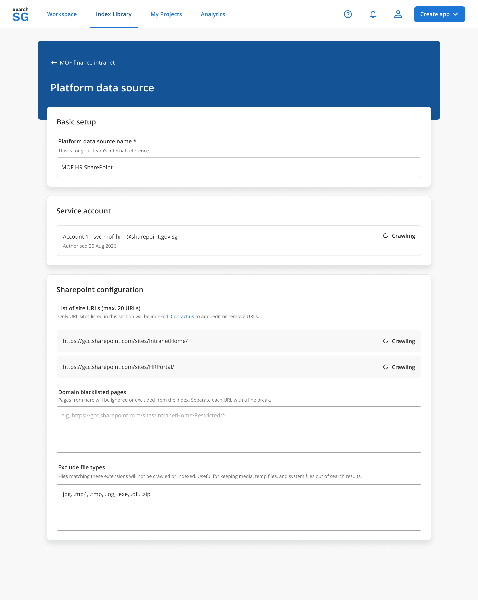
    - `Active`: The site is active. Check every listed site, as individual sites may have different statuses.
    - `Within limit`: The service account's indexed content is within the recommended limit.
    
    - `Error` or `Over limit`: See [Part 6: Resolve Access and Content-Limit Issues](index-enterprise-sharepoint.md#part-6-resolve-access-and-content-limit-issues).

Indexing may take some time, depending on the amount of content. If content is still missing after indexing completes, check the site list, service account access and content exclusions.

### Part 6: Resolve Access and Content-Limit Issues

#### If a Site Shows a Permission Error

If a site shows `Error` with **The service account does not have permission to this site**, its content cannot be crawled or indexed.
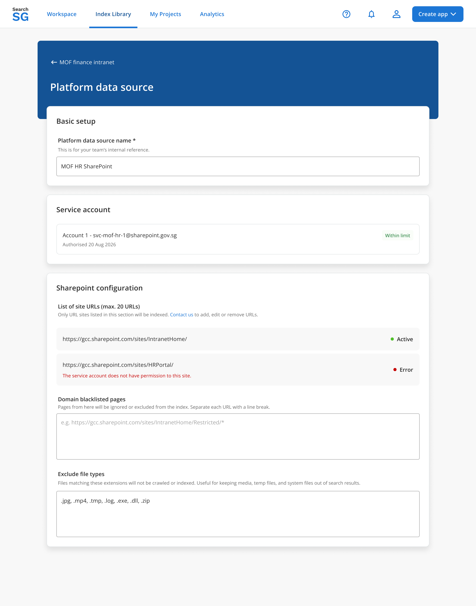

1. Check which site URLs are affected.
2. Ask your agency's SharePoint administrator to ensure the service account has site admin access to those sites, including all files, folders, pages and their ACLs.
3. Contact SearchSG Support if you need to change the service account or submitted site URLs.
4. Check the site status again after access has been restored.

#### If a Service Account Shows Over Limit

`Over limit` means the service account has exceeded the recommended indexed-content size. Search and indexing may be slower, even if the sites still show `Active`.
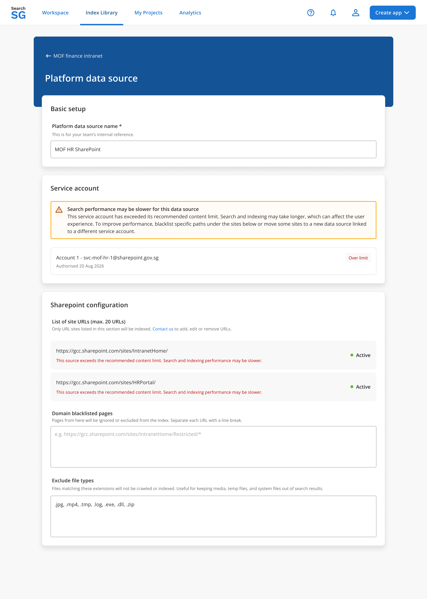

To reduce the amount of indexed content:

- Use **Domain blacklisted pages** to exclude unnecessary paths.
- Use **Exclude file types** to exclude file formats your agency does not need in search.
- Contact SearchSG Support to move sites to another data source linked to a different service account. You cannot change the submitted site URL list yourself.

After making changes, monitor indexing and check whether the account returns to `Within limit`. Contact SearchSG Support if you need help understanding the recommended limit.

### Part 7: Request Additional Service Accounts

If your agency needs more service accounts for additional sites or capacity:

1. Open your index's **Data Sources** tab.
2. Click **"Service accounts"** under **Microsoft SharePoint**.
3. Click **"+ Add service account"**.
4. Choose the number of additional accounts required and click **"Add"**.
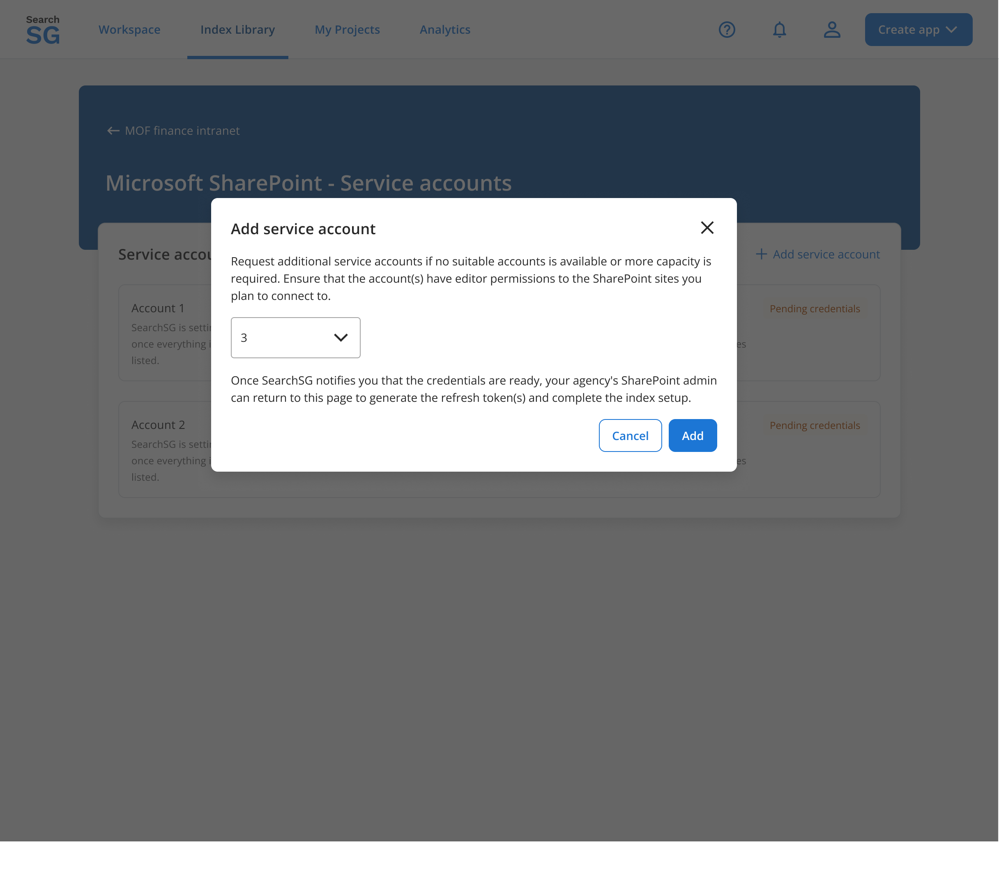

The new accounts will appear with `Pending credentials` status. Ensure they have site admin access to the sites your agency plans to connect, including all files, folders, pages and their ACLs.
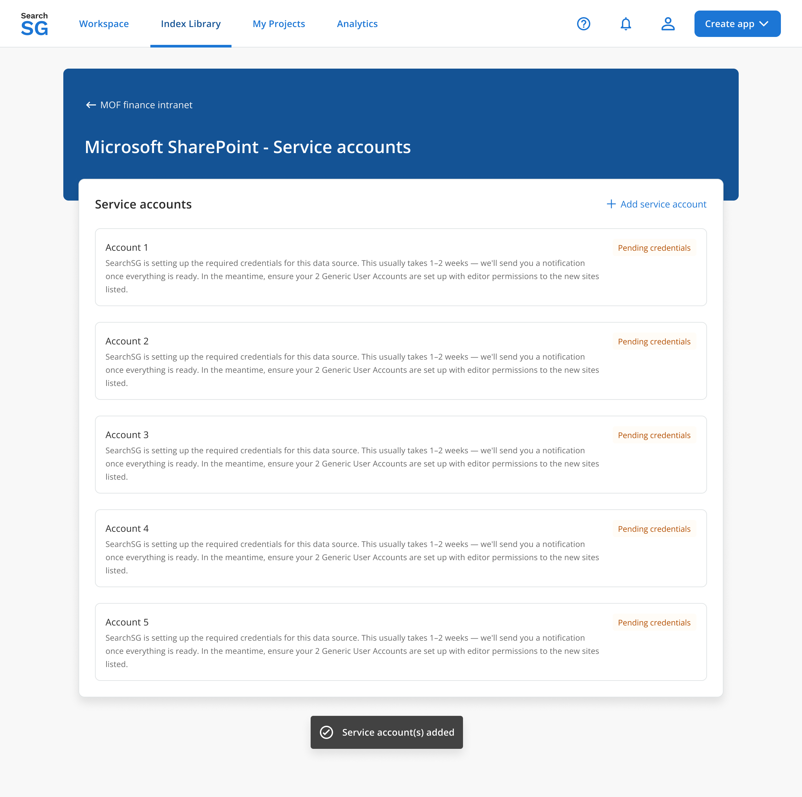

Wait for SearchSG Support to confirm that the credentials are ready, then follow [Part 4](index-enterprise-sharepoint.md#part-4-authorise-and-verify-service-accounts) to authorise and verify the accounts.

### Troubleshooting

| Issue | What to do |
|---|---|
| Unsure which tenant you use | Check with your agency's IT administrator. |
| Credentials are still pending | Ensure your agency has completed the account request and access arrangements. Wait for SearchSG Support's confirmation before continuing. Contact support to check progress. |
| Account authorisation fails | Click **"Sign in again"**, use your agency's service account and accept the requested permissions. Use a fresh incognito session for each account. |
| Account verification fails | Check site admin access to all listed sites, including files, folders, pages and their ACLs. Retry **"Verify connection"**. |
| A request cannot proceed | Check your connection and retry. Contact SearchSG Support if the issue persists. |
| Content is missing after indexing | Check that the site is listed, the service account has access, and the content is not excluded by **Domain blacklisted pages** or **Exclude file types**. |
| No confirmation email received | Contact SearchSG Support for help with the next steps. |

!> Do not send passwords, client secrets or tokens through ordinary email. Ask SearchSG Support for the approved method of providing any required credentials.
