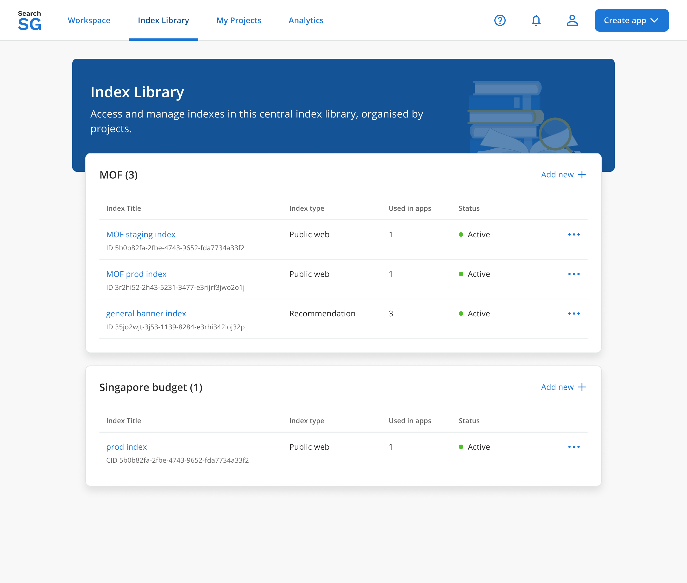
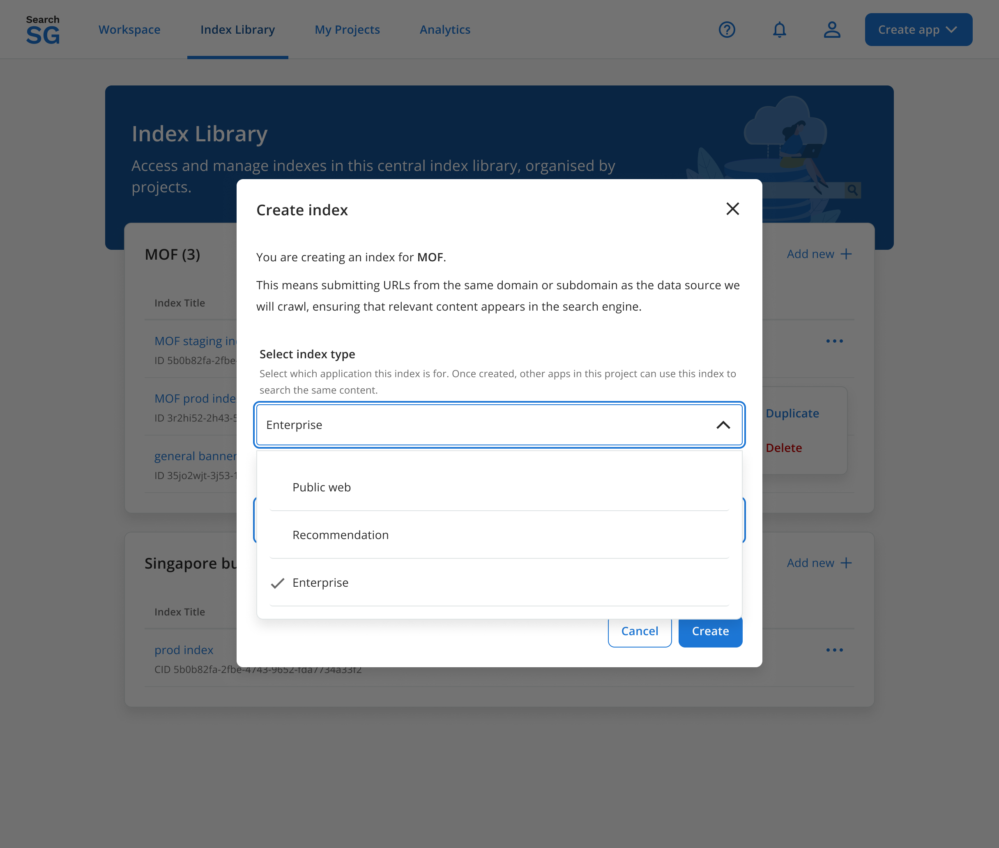
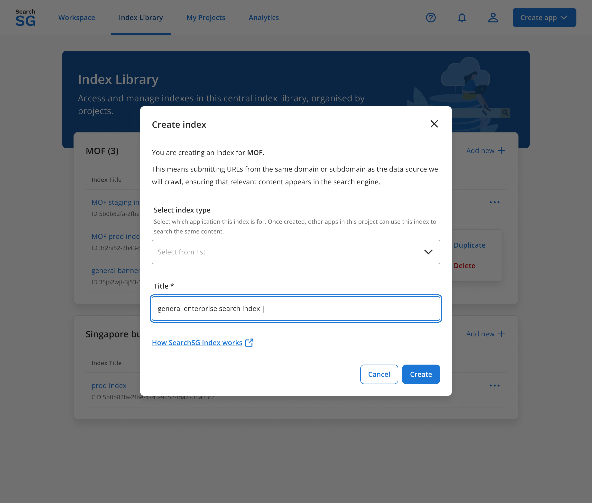
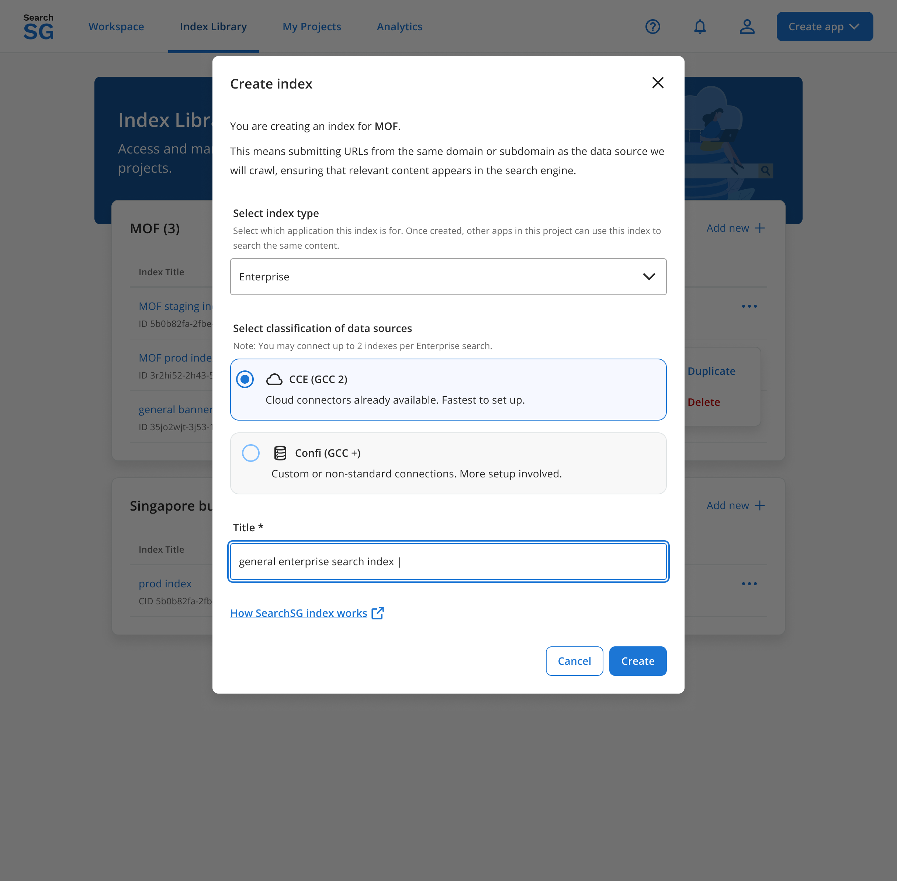
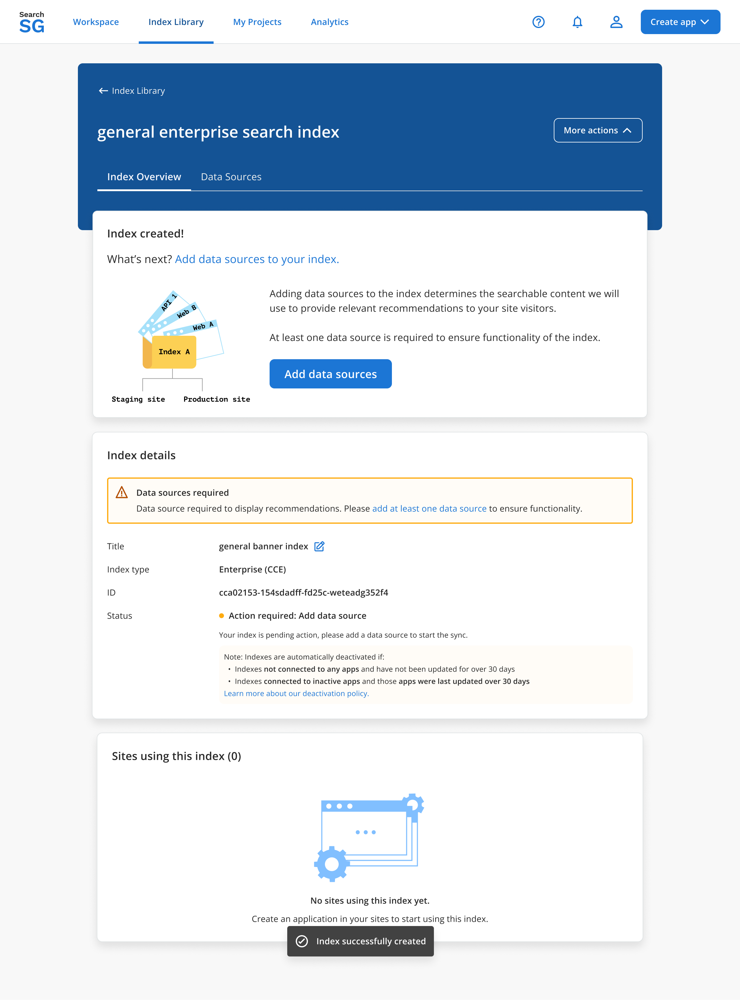
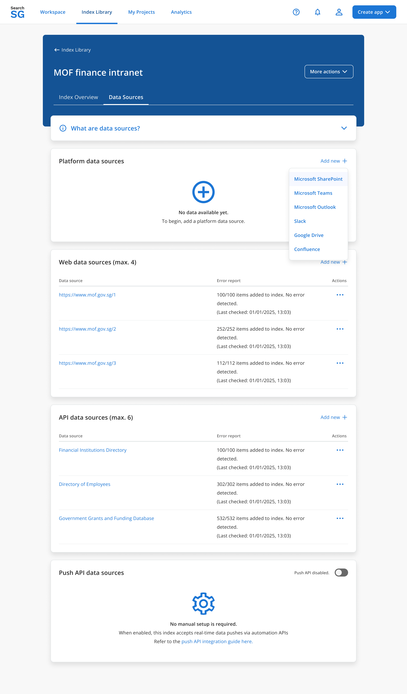

## Enterprise Index

An Enterprise Index organises the content that SearchSG searches for your enterprise search experience. You can connect supported data sources, such as SharePoint Online, to ingest content into the index.

An index and a data source are separate concepts:

- **Enterprise Index**: The index used to search your content.
- **Data source**: The configuration that identifies where content comes from and how SearchSG connects to it.

?> Creating an index does not automatically connect a repository or start indexing. Add and configure the required data sources after creating the index.

### Supported Data Source Types

| Data source type | Description |
|---|---|
| **Platform Data Source** | Connect content from supported platforms, including SharePoint Online, SharePoint on-premises, Slack, Confluence, Microsoft Teams, Outlook and OneDrive. See [Platform Data Sources](index-enterprise.md#platform-data-sources). |
| **Web Data Source** | Configure websites as a content source. See [how Web Data Sources work](https://docs.developer.tech.gov.sg/docs/searchsg-onboarding-guide/indexing-features?id=a-web-data-source). |
| **API Data Source** | Allow SearchSG to poll and retrieve data through an agency-owned API. See [how API Data Sources work](https://docs.developer.tech.gov.sg/docs/searchsg-onboarding-guide/indexing-features?id=b-api-data-source). |
| **Push API Data Source** | Send content to SearchSG by calling the SearchSG API. See [how Push API Data Sources work](https://docs.developer.tech.gov.sg/docs/searchsg-onboarding-guide/indexing-features?id=c-push-api-data-source). |

### Getting Started

1. [Create an Enterprise Index](index-enterprise.md#how-to-create-an-enterprise-index) from the `Index Library`.
2. Open the **Index Overview**.
3. Add a supported data source.
4. Complete the connection or ingestion setup required for that data source.
5. Review its status to confirm whether indexing has begun.

### How to Create an Enterprise Index

#### Step 1: Open the Index Library

- In the SearchSG Admin Portal, navigate to the `Index Library` page using the top navigation menu.

#### Step 2: Add a New Index

- Click **"Add new +"** within the project card that you want to add your index to. This opens the **Create index** pop-up window.

#### Step 3: Choose the Enterprise Index Type

- Under **Select index type**, open the dropdown and select `Enterprise`.

#### Step 4: Enter the Index Title

- Enter a title that clearly identifies the index's purpose.
- The title must not be empty or duplicate an existing index title. If a validation message appears, correct the title before continuing.

#### Step 5: Select the Data Classification

- Under **Select classification of data sources**, choose the classification appropriate for the content you intend to connect:
    - `CCE (GCC 2)`
    - `Confi (GCC +)`
- Your selection determines the classification of data that this index will serve in search results. Ensure that it matches the intended classification of your data sources.

!> If you are unsure which option to select, [contact SearchSG Support](https://go.gov.sg/searchsg-request) before proceeding.

#### Step 6: Create the Index

- Review the index type and title, then click **"Create"**.
- If creation fails, review the error message and retry after addressing the issue. Your entered details should remain available in the form.

#### Step 7: Review the Index Overview

- After successful creation, you will be taken to the **Index Overview**. The index status will show `Action required: Add data source`.

?> A newly created index has no data sources until you add them. Creating the index alone does not start content ingestion or indexing.

### Platform Data Sources

Platform data sources connect your agency's content platforms to an Enterprise Index, allowing users to search content from those platforms through SearchSG.

Each platform has its own connection, authorisation and access requirements. Follow the relevant platform guide to complete the setup.

#### Supported Platforms

Use the table below to identify your platform and prepare for onboarding. The information to prepare is a starting checklist; SearchSG Support will confirm the exact connection requirements and supported content scope for your agency.

| Platform / environment | How to identify your setup | Onboarding approach | What your agency should prepare |
|---|---|---|---|
| **SharePoint Online — WOG tenant** | Your SharePoint sites are hosted in the centrally managed WOG Microsoft 365 tenant. Confirm with your IT administrator if unsure. | Self-onboarding is available for WOG tenant (CCE). Follow [SharePoint Online Data Source](index-enterprise-sharepoint.md). Account requests and site access arrangements still require offline coordination. | The SharePoint site URLs to index, the intended content scope and an agency IT contact. Contact SearchSG Support for the required support emails and account/access setup guidance. |
| **SharePoint Online — agency tenant** | Your agency manages its own Microsoft 365 tenant, rather than using the WOG tenant. | Contact SearchSG Support to confirm the onboarding approach and tenant-specific requirements before configuring the connection. | Tenant details, SharePoint site URLs, intended content scope and a tenant administrator who can coordinate permissions and approvals. |
| **SharePoint on-premises** | SharePoint is hosted on infrastructure managed by your agency, rather than SharePoint Online. | Contact SearchSG Support to assess the connection and access requirements with your agency's IT team. | SharePoint version, site URLs, hosting/network details and an administrator contact. Confirm which content is intended for indexing. |
| **Slack** | Your content is held in Slack workspaces and channels. | Contact SearchSG Support for workspace-specific onboarding instructions and confirmation of the supported content scope. | Workspace details, intended channels/content scope and a workspace administrator who can coordinate access approvals. |
| **Confluence** | Your content is held in Confluence sites and spaces. | Contact SearchSG Support to confirm the setup for your Confluence deployment. | Site URL, deployment type (cloud or self-hosted), intended spaces/content scope and an administrator contact. |
| **Microsoft Teams** | Your content is associated with Microsoft Teams teams and channels. | Contact SearchSG Support to confirm the tenant requirements and which Teams content can be connected. | Microsoft 365 tenant details, intended teams/channels, content scope and a tenant or Teams administrator contact. |
| **Outlook** | Your content includes emails and calendar invites associated with Outlook mailboxes. | Contact SearchSG Support to confirm the mailbox connection, supported content scope and authorisation requirements. | Microsoft 365 tenant details, intended mailboxes/content scope and the relevant mailbox owner or administrator contact. |
| **OneDrive** | Your content is held in OneDrive accounts and folders. | Contact SearchSG Support to confirm the account connection and supported content scope. | Microsoft 365 tenant details, intended accounts/folders and the relevant account owner or administrator contact. |
| **Custom repository** (e.g. RMS, ITSM or Salesforce) | Your content is held in a repository or business system, such as a Records Management System (RMS), an IT Service Management (ITSM) system or Salesforce, and is connected through the API or Push API approach rather than a standard platform connector. | Integrate through **API Data Source**, where SearchSG polls and retrieves data through an agency-owned API, or **Push API Data Source**, where your agency sends content by calling the SearchSG API. Contact SearchSG Support to discuss the appropriate approach. | Repository details, intended content scope and classification, available API documentation, access-control requirements and a technical contact. For the API approach, identify the endpoints SearchSG can poll; for Push API, identify how your agency will prepare and send content. |

Before contacting SearchSG Support, confirm the intended data classification and identify the content your agency has approved for indexing.

!> Do not send passwords, client secrets or tokens through ordinary email. Ask SearchSG Support for the approved method if credentials are required.

#### Before You Begin

- Ensure you have project owner or editor access to the relevant project.
- [Create an Enterprise Index](index-enterprise.md#how-to-create-an-enterprise-index) or open an existing one.
- Confirm that the index's data classification is appropriate for the content you intend to connect.
- Identify the content and access scope to be included.
- Coordinate with your agency's platform administrator on any required accounts, permissions or approvals.

?> Creating a platform data source does not necessarily mean it is connected or ready to index. Complete the required setup and review its status before expecting content to appear in search results.

#### How to Add a Platform Data Source

1. **Open the Enterprise Index**: Open the `Index Library` and select the relevant Enterprise Index.
2. **Add a new platform data source**: Select the **Data Sources** tab, then click **"Add new +"** under **Platform data sources**.
3. **Select the platform**: Choose the platform you want to connect. Confirm that it is appropriate for the index's data classification and your agency's environment. [Contact SearchSG Support](https://go.gov.sg/searchsg-request) if you are unsure which platform or setup to use.

4. **Configure the data source**: Follow the platform-specific instructions to enter the required data source details and identify the content to be indexed.
    - For SharePoint Online in the WOG tenant (CCE), follow [SharePoint Online Data Source](index-enterprise-sharepoint.md).
    - For other platforms, contact SearchSG Support to confirm availability, onboarding requirements and the relevant setup instructions.
5. **Complete account and access setup**: Coordinate with your agency's platform administrator to complete any required accounts, permissions and approvals. Some of these activities take place outside the Admin Portal.
6. **Verify the connection**: Complete the platform's required authorisation and connection verification steps. Saving the data source alone does not confirm that it can access your content or begin indexing.
7. **Check the data source status**: Review the data source status to confirm whether syncing or indexing has begun.

#### Troubleshooting

| Issue | What to do |
|---|---|
| Unsure which platform or classification to select | Contact SearchSG Support to confirm the appropriate setup. |
| Account or access setup is incomplete | Coordinate with your agency's platform administrator and SearchSG Support. |
| Connection or verification fails | Follow the platform-specific error guidance and contact SearchSG Support if the issue persists. |
| Data source saved but content is not available | Check that the required setup is complete and review the syncing or indexing status. |
