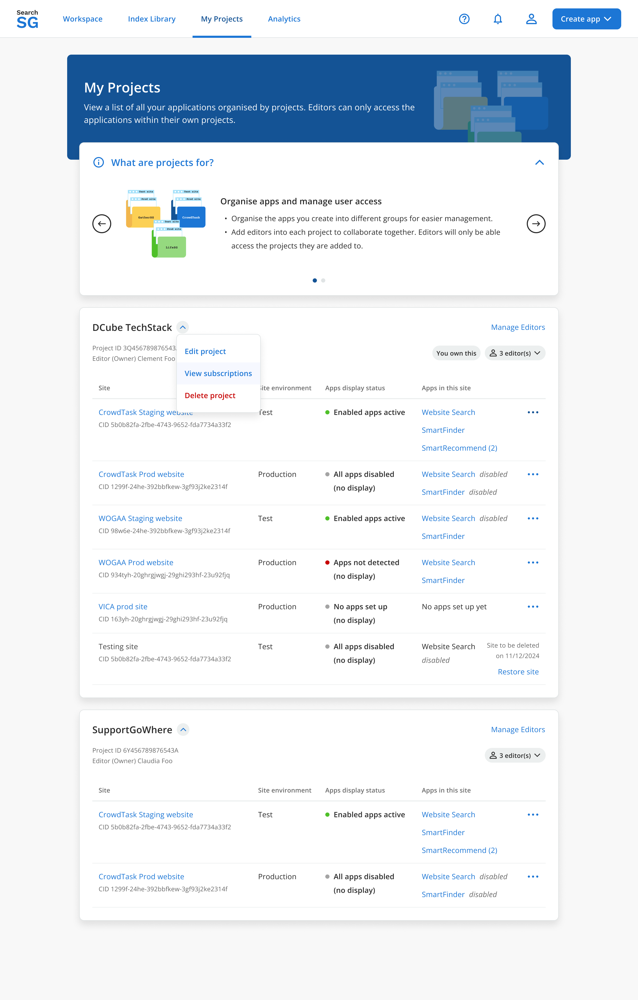
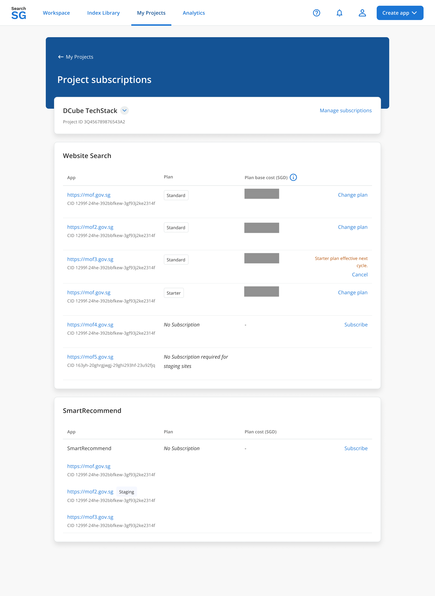
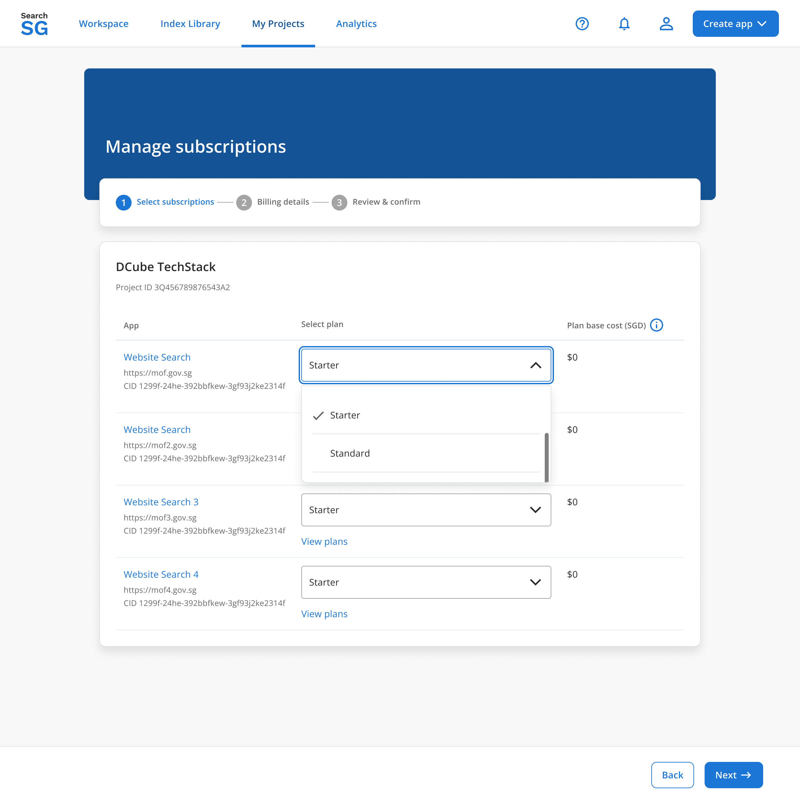
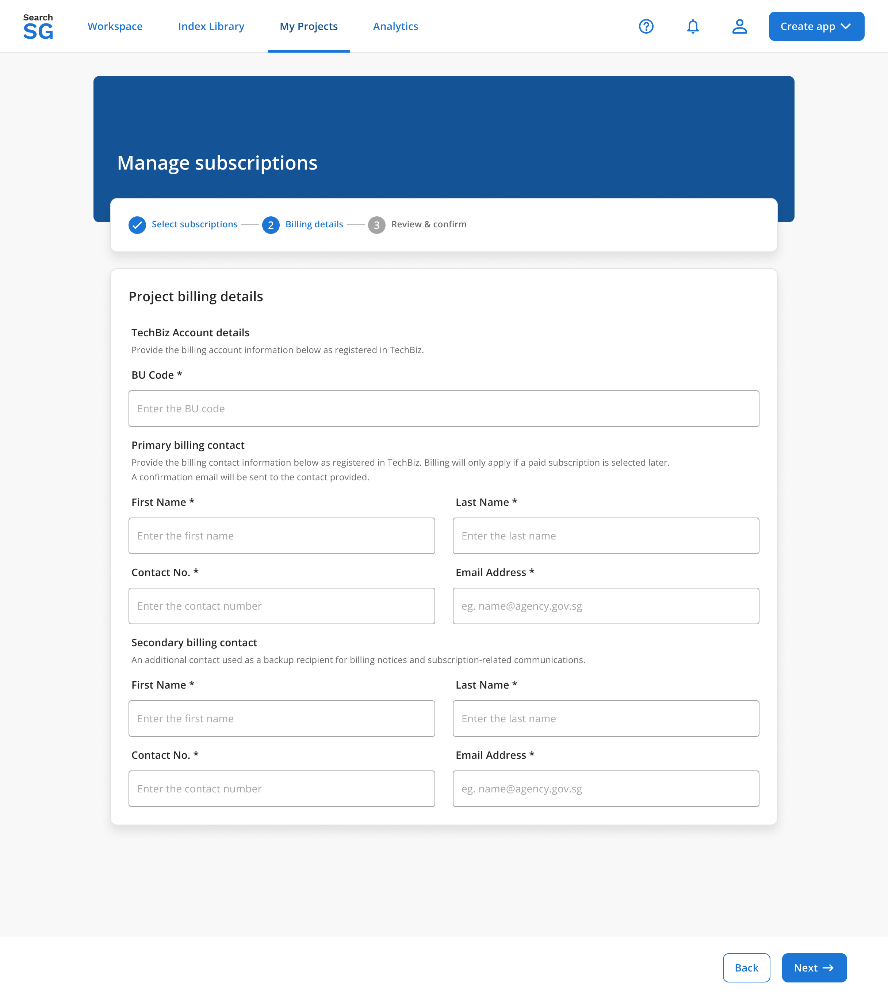
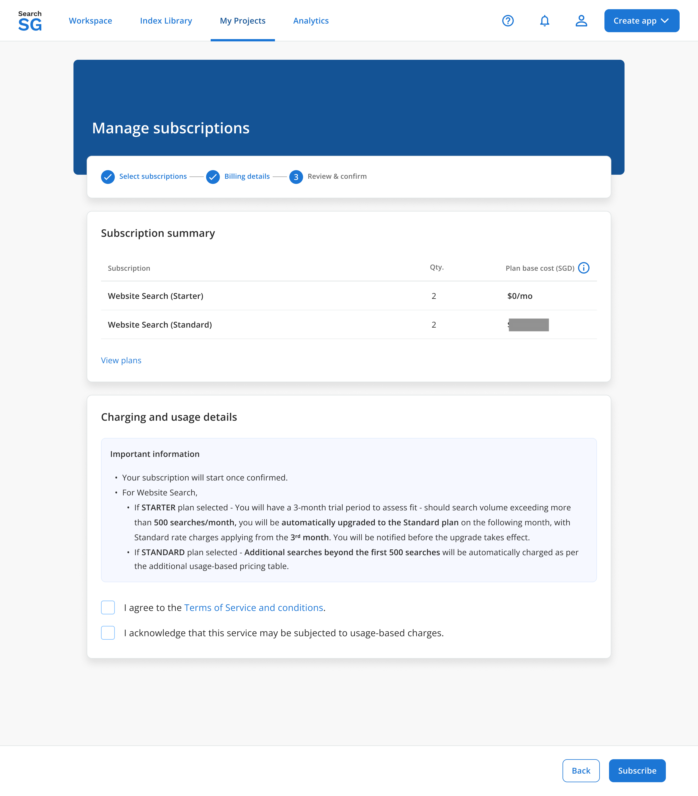

## Subscription

### Overview

A subscription is required to activate and use applications within SearchSG.

Subscriptions are assigned at the **application level**, meaning each application must have an active subscription before it can function in production.

This section explains how subscriptions are created, managed, and applied during application onboarding.

### How to Subscribe

Subscription is completed as part of the application onboarding flow.

**Note**: A subscription is only required for applications created for **production use**. Applications in testing environments do not require a subscription.

During setup, you will be prompted to enter and assign your subscription details.

To subscribe, follow the step-by-step instructions in:
- Complete subscription setup for **Website Search** - _Coming soon_
- Complete subscription setup for **SmartRecommend** - _Coming soon_
- Complete subscription setup for **Directory Search** - _Coming soon_

### Manage Subscription

You can manage your subscriptions at any time from the Project Subscription page.

#### How to view subscription details
<i>(Coming Soon)</i>

#### How to upgrade a subscription (Website Search only)
<i>(Coming Soon)</i>

#### How to downgrade a subscription (Website Search only)
<i>(Coming Soon)</i>

#### How to cancel a subscription
<i>(Coming Soon)</i>

### Bulk Subscription Management

Bulk subscription management is used to manage subscriptions across multiple applications efficiently for agencies that have already onboarded to SearchSG.

This allows you to:
- Assign subscriptions to multiple applications at once
- Reduce repetitive manual setup

**Note**: Bulk subscription management is only applicable to applications created for **production use**. Applications in testing environments do not require a subscription.

#### How to update a subscription for existing Website Search apps?

1. Login to Admin Portal.

2. Navigate to "My Projects" and click on "View subscriptions" under the dropdown menu next to your project.

    

3. Click on "Manage subscriptions"

    You can view a list of production website search applications along with their current subscription details. From this page, you can manage and update your subscriptions as needed.
    

4. Select Tiering

    Assign a subscription tier for each production application. This step is mandatory for all production applications.
    

5. Enter Billing Information

    Provide both primary and secondary billing account details. This is mandatory. Both accounts will receive monthly invoices and have access to the TechBiz portal to manage the subscription. 
    For more information on managing subscription accounts, please refer to the [TechBiz documentation](https://docs.developer.tech.gov.sg/docs/techbiz-documentation/admin-roles-and-permissions?product=techbiz&id=admin-roles-and-permissions).
    

6. Preview Subscription

    After entering the billing information and assigning a tier to each production application, you will be redirected to a preview page showing your selected subscription details. 
    Review the information carefully, then click **"Subscribe"** to complete your subscription.
    

7. Complete Subscription

    Once your subscription has been successfully updated in the system, you will be redirected to the **"View Subscription"** page. Your latest subscription details will be reflected there.